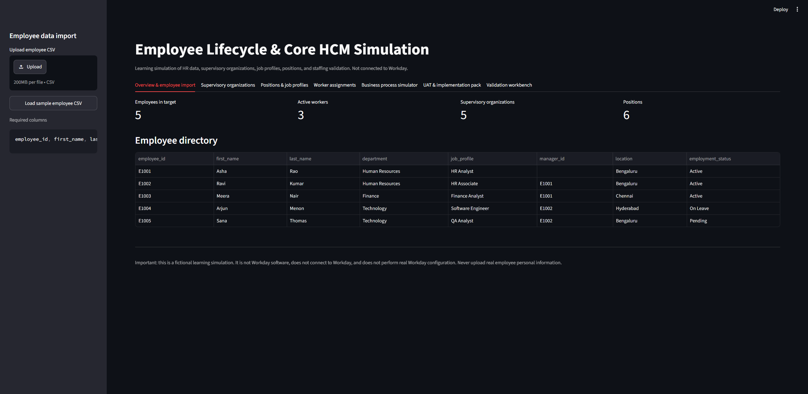

# Employee Lifecycle & Core HCM Simulation

A local Streamlit learning project that simulates selected HR data and Core HCM concepts relevant to entry-level HCM implementation work. **It is not Workday software and does not connect to Workday.**

## Features

- Employee CSV import, required-field/status/duplicate/manager validation, SQLite storage, and source-to-target ID reconciliation.
- Supervisory organization hierarchy with parent-child relationships and circular hierarchy validation.
- Position management with job profiles, departments, locations, supervisory organization references, and Open/Filled/Frozen/Closed status.
- Worker-to-position assignments that mark an open position as Filled.
- Manager hierarchy validation for missing managers, self-management, and circular reporting chains.
- Employee lifecycle business-process simulator for hire, transfer, promotion, and termination scenarios with approval checks (simulation only).
- UAT register, requirements traceability matrix, source-to-target mapping, and mock cutover checklist, downloadable as CSV files.
- JSON/XML and generic SOAP envelope learning examples in `docs/integration_examples/`.
- Downloadable validation report and Core HCM-style test scenarios.
- Fictional sample data only.

## Run on Windows (VS Code / PowerShell)

1. Extract the ZIP and open the `hr-data-validation-system-core-hcm` folder in VS Code.
2. In Terminal > New Terminal, run:

```powershell
python -m venv .venv
.\.venv\Scripts\Activate.ps1
python -m pip install --upgrade pip
python -m pip install -r requirements.txt
python -m pytest -v
python -m streamlit run app.py
```

If PowerShell blocks activation, run `Set-ExecutionPolicy -Scope Process -ExecutionPolicy Bypass` in that terminal, then activate again. Open the local URL Streamlit prints (normally `http://localhost:8501`).

## Suggested demo flow

1. Open **Overview & employee import** and click **Load sample employee CSV**.
2. Review the validation summary and import valid records.
3. Open **Supervisory organizations** to inspect the sample hierarchy and add a child organization.
4. Open **Positions & job profiles** to inspect positions or add an Open position.
5. Open **Worker assignments** to assign an imported employee to an open position.
6. Open **Business process simulator** to evaluate a hire/transfer/promotion/termination scenario with simulated manager and HR approvals.
7. Open **UAT & implementation pack** to download the UAT register, mapping, traceability matrix, and mock cutover checklist.
8. Open **Validation workbench** to review manager/position checks and download the test scenarios CSV.
9. Upload `data/sample_employees_with_errors.csv` to demonstrate detection of duplicate IDs, missing names, invalid status, and unknown managers.

## Database and reset

The app creates `hr_records.db` locally on first run. To reset all demo records, stop Streamlit and delete `hr_records.db`; it will be recreated with the sample organization and position records the next time the app starts. This also deletes any employees you imported.

## Limitations

- This is a simulated data model, not a full HR system.
- It has no Workday tenant or actual Workday API integration. Lifecycle approval logic, UAT materials, and cutover materials are simulated learning artefacts, not actual Workday business-process configuration or production cutover tooling.
- Organization manager IDs are illustrative references; employee manager relationships are validated separately.
- Use synthetic data only; do not upload real employee personal information.
## Application Screenshot

